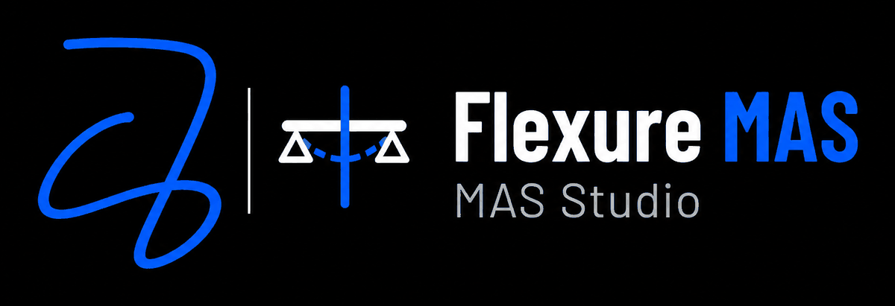

<p align="center"></p>

<h1 align="center">Flexure MAS</h1>

<p align="center"><b>Free, open-source beam analysis for engineering students.</b><br>
Shear force and bending moment diagrams, slope, deflection, axial force, torsion and a 3D view, for any beam, in SI or US units.</p>

<p align="center">
  <a href="https://al-shahriar-12.github.io/flexure-mas/"><b>Open Flexure MAS</b></a> ·
  <a href="#how-to-use">How to use</a> ·
  <a href="FMAS-FORMAT.md">.fmas file format</a> ·
  <a href="CONTRIBUTING.md">Contribute</a> ·
  <a href="#author">Author</a>
</p>

<p align="center">
  
  
  
</p>

<p align="center">
  
  
  
  
</p>

## What it does

Flexure MAS is a beam calculator that runs entirely in your browser. Build a beam, and every diagram updates as you type.

- **Supports:** fixed, pin, roller and guided (slider) supports, plus internal hinges, anywhere along the beam. Determinate and indeterminate beams both work, and the app reports the degree of indeterminacy or warns when the beam is a mechanism.
- **Loads:** point loads, uniform loads (UDL) and linearly varying loads (UVL) acting down, up, sideways (±Z) or along the beam (±X), plus point moments about Z or Y and torques about X. Self-weight is optional.
- **Results:** shear force (SFD), bending moment (BMD), slope and deflection; axial force and axial displacement; shear and moment in the second plane (Vz, My); torque; peak normal and shear stress.
- **Section cut:** drag across any diagram to read exact values at any point, with left and right values at jumps.
- **3D view:** rotate the beam and show moment diagrams about X, Y and Z one at a time or together, shear and axial diagrams, reactions and the magnified deflected shape.
- **Summary:** reactions, maximum and minimum values with their locations, deflection by span as L/δ, section properties, values at stations and an equilibrium check.
- **Units:** SI (kN and m, or N and mm) and US customary (kip and ft, kip and in, lb and ft), converted exactly.
- **Sections and materials:** I-section, rectangle, circle, pipe or custom properties; steel, concrete, aluminium, timber or custom.
- **Files:** save and open `.fmas` project files to share beams with classmates.
- **Offline and installable:** after the first visit it works without internet, and you can install it like an app.

## How to use

1. Open **https://al-shahriar-12.github.io/flexure-mas/** on a phone or computer.
2. Pick an example in **Model → Example**, or press **New beam** and add your own supports and loads.
3. Read the diagrams in the **Diagrams** tab and drag the section cut to any point.
4. Check the **3D** and **Summary** tabs for the full picture.
5. Press **Save .fmas** to keep your beam; **Open file** loads it again later. The `examples` folder has ready-made files to try.

**Install it as an app:** on Android, open the site in Chrome and choose **Install app** (or menu ⋮ → **Add to Home screen**). On iPhone, open it in Safari and choose Share → **Add to Home Screen**. On a computer, use the install icon at the right of Chrome’s or Edge’s address bar.

## How accurate is it?

Flexure MAS uses the direct stiffness method with Euler–Bernoulli beam elements and consistent nodal loads, so results at supports, loads and hinges are exact for linear elastic beams. Shear and moment come from exact statics using the solved reactions; slope and deflection are integrated from M/EI and matched to the exact nodal values.

`tests/verify.js` checks the solver against 23 textbook results, including simply supported, cantilever, propped cantilever, fixed–fixed, continuous and hinged beams and axial bars. Run it with Node.js:

```bash
node tests/verify.js
```

Assumptions: small deflections, no shear deformation, Saint-Venant torsion without warping, and no buckling or P-delta effects. Treat Flexure MAS as a learning and checking tool; verify design work with your code of practice and a qualified engineer.

## Run it yourself

There is no build step. The whole app is `index.html` (the fonts are built in), plus `three.min.js` for the 3D view.

- Double-click `index.html` to open it in a browser, or
- serve the folder locally: `python -m http.server 8000`, then open `http://localhost:8000`.

The `android` folder contains a small Android wrapper if you want to build an APK; see `android/README.md`.

## Project structure

| Path | Purpose |
| --- | --- |
| `index.html` | The complete app: interface, solver, diagrams, 3D view, units, files, About page and fonts |
| `three.min.js` | three.js r128 for the 3D view (MIT licence) |
| `logo.png`, `author.jpg` | Logo and author photo, shown in the app’s About tab and here |
| `manifest.webmanifest`, `sw.js`, `favicon.svg`, `icon-*.png`, `apple-touch-icon.png` | Installable app and offline support |
| `og-image.png`, `sitemap.xml` | Link previews and Google indexing |
| `FMAS-FORMAT.md` | Specification of the `.fmas` file format |
| `screenshots/` | Pictures used in this README |
| `examples/` | Sample `.fmas` beams |
| `tests/verify.js` | Solver checks against textbook formulas |
| `android/` | Optional Android app wrapper |

## Contributing

Bug reports, ideas and improvements are welcome. Please [open an issue](https://github.com/Al-Shahriar-12/flexure-mas/issues), or read [CONTRIBUTING.md](CONTRIBUTING.md) before sending a pull request.

## Licence

Flexure MAS is released under the [MIT License](LICENSE): you may use, copy, change and share it freely, including in courses, as long as the copyright notice stays with it. three.js is MIT-licensed, and the Barlow fonts built into `index.html` use the SIL Open Font License 1.1 ([OFL.txt](OFL.txt)).

## Cite

If Flexure MAS helped your study, thesis or teaching, please cite it. GitHub’s **Cite this repository** button (from `CITATION.cff`) gives the reference in APA or BibTeX.

## Author


**MD Al Shahriar**<br>
BSc. in Civil Engineering, Bangladesh University of Engineering and Technology (BUET)<br>
Creator of Flexure MAS, MAS Studio<br>
GitHub: [@Al-Shahriar-12](https://github.com/Al-Shahriar-12)

<br clear="left">

Flexure MAS is free for every engineering student. If it helped you, please remember its author in your duas.
